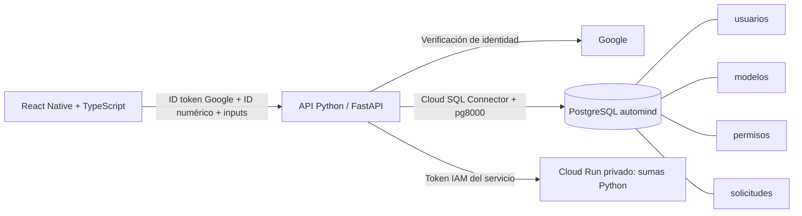

# Arquitectura PostgreSQL

`usuarios.google_sub` es el identificador estable de Google; `email` es único. `modelos.id` es INTEGER entre 10000000 y 99999999. `modelos.archivo` contiene una ruta relativa de GitHub como `inference/modelos/inmobiliario/cart.py`.

`permisos` tiene clave primaria `(email,modelo_id)` y una clave foránea compuesta `(usuario_id,email)` a usuarios. Un permiso reservado puede tener usuario_id NULL antes del primer login. El registro usa el token validado y vincula únicamente las reservas del mismo Gmail. No concede nuevos IDs.

`solicitudes` tiene clave primaria `(usuario_id,modelo_id)` y claves foráneas a usuarios y modelos. Cambiar su estado no habilita un permiso. La cuota técnica se guarda en dos columnas de usuarios; no hay quinta tabla.

## API

- `GET /v1/catalog`: modelos activos desde PostgreSQL.
- `GET /v1/me`: Gmail verificado, IDs permitidos y solicitudes pendientes.
- `POST /v1/requests`: `{ "modelId": 10000002 }`.
- `POST /v1/models/10000002/predict`: `{ "inputs": { "input1": 10, "input2": -3, "input3": 0.5 } }`.

Todas las rutas verifican Google. Los cuerpos no aceptan un email de autorización. El frontend no administra permisos y no se conecta a SQL. El backend usa parámetros SQLAlchemy `:email`, `:id`, etc.; los valores de usuario no se concatenan en SQL.

El catálogo muestra metadatos. El motor selecciona código mediante un registro fijo ID-módulo y verifica MODEL_ID. No ejecuta directamente el contenido de archivo en la base ni descarga Python de GitHub al calcular. La copia desplegada contiene los 24 archivos.

El rol PostgreSQL de la API solo tiene SELECT, INSERT de usuarios/solicitudes y UPDATE de columnas concretas. La edición de catálogo y concesión de permisos se realiza administrativamente en Cloud SQL Studio.

El backend de API utiliza Python: automind_api/app.py (rutas), auth.py (google-auth), repository.py (SQLAlchemy), database.py (Cloud SQL Python Connector) y predictor.py (llamada IAM al motor Python privado). Los dos contenedores ejecutan Python; TypeScript solo permanece en mobile.
